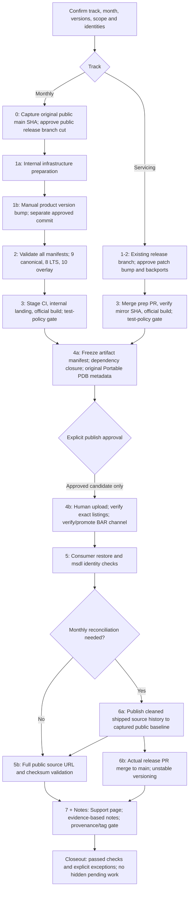

# Release workflow and guided checkpoints

This is the canonical navigation and approval contract for all four playbooks. Load it at session start, including resumed/status sessions, before the selected playbook README. Present this diagram to the user (not merely a link), mark the active node in the accompanying checkpoint, and redisplay the relevant path at meaningful stage/gate changes. Load only the current stage's detailed reference. An explanation/status request remains read-only.

The arrows describe dependencies, not implicit approvals. Stage 4a's metadata gate precedes immutable publication; full source URL validation follows public source reachability (6a for monthly releases). Do not require full URL validation before the action that makes that source public. Stage 6b and notes drafting may proceed while independent verification is pending when explicitly authorized; that is not validation sign-off.

## Checkpoint and approvals

At start, stage changes, gates, and blockers, show a compact checkpoint:

| Field | Required content |
|---|---|
| CURRENT | Track, stage/node and substep; distinguish implemented, validated, reviewed, committed, pushed |
| Completed / remaining | Evidence-backed steps; `passed`, `failed`, `not-run`, `waiting`, `deferred`, `waived`, `not-applicable` are distinct |
| Identity | Release month/version, public baseline SHA, candidate source SHA, AzDO/BAR IDs, manifest hash as available |
| Exact next action | Concrete safe action now, or one named approval with operation/ref/SHA/destination |
| Owner / run location | Agent or human, owning session/worktree/path/branch; privileged work runs in the human terminal |
| Blockers | Actual failed prerequisite, permission prompt, or dependency still running; do not call waiting complete |

Maintain a compact approval/evidence ledger in session SQL or a retained session artifact, not in release source. Each entry records operation, user decision, scope, refs/SHAs, build/manifest identities, evidence, timestamp, owner, and status. A defer/waiver records the precise failed or unrun check, reason, risk, owner and revisit/closeout decision; never relabel it `passed`. Revalidate identities after reboot/resume or scope changes. Changed source/dependencies/package scope invalidate the candidate build/manifest and dependent approvals; build new evidence, do not reuse an old green run.

Name gates: **target/baseline**, **commit**, **push**, **queue/test policy**, **land/merge**, **artifact manifest/metadata**, **publish**, **promote**, **validation exception**, **tag/release**. Approval is specific to the named operation and captured identity. Natural affirmative replies such as "yes", "proceed" or "continue" **do approve** one clearly presented pending named gate whose identity and scope are known and unchanged; no magic phrase or repeated confirmation is required. For example, after "Push `stage-release-10.11` at `<full-sha>` to the verified internal remote's `refs/heads/stage-release-10.11`?", "proceed" approves that push alone, not a pipeline queue. Generic continuation without such a gate, an autopilot completion reminder, silence, or "user unavailable" is not approval for a mutation. If multiple gates are pending, clarify which operation is approved rather than extending an ambiguous reply to all of them. Do not repeatedly ask for scope already approved and unchanged. Continue concrete read-only checks and authorized preparation proactively, then stop at the next unapproved gate. Always commit, report the resulting SHA, and wait for a separate explicit push instruction. No stage auto-commits.

Release-owned commits intended for public history retain the Copilot co-author and omit `Copilot-Session`; propagate this policy to any release-owned child and inspect all outgoing commit messages before push. This policy does not apply to unrelated agent-maintenance work. Never amend, force-push, squash, change repository rules, or bypass denied permissions to advance.

## Ownership, handoffs and waits

Before a handoff or mutation, capture the owning session, absolute worktree path, branch, exact HEAD SHA, destination URL/ref and PR base. Resolve remotes by URL. Prefer `git -C "<owning-worktree>" ...`; immediately before push compare that worktree's HEAD, branch, outgoing commits/diff and destination to the approval. A parent worktree is not interchangeable with a cleaned child. Do not switch/mutate another session's branches, delete user work, or automatically archive persistent child work.

Preflight any child's mode and permissions before delegation. A running child, pending interactive approval, retry in progress, and denied permission are different states. Allow normal interactive approval/retry, never bypass a denial. Do not report completion or a final blocker while required work is still running. A shell's "completed successfully" is not proof of its build/test result.

For propagation/mirroring/build monitoring, pin identities and agree a bounded window (default: three checks over 30 minutes for availability, then stop and reassess; long builds have their own explicit window). Record last observation and exact resume command; emit updates only on meaningful changes. On expiry, recheck intended release/version/month, source/build, transport and policy before proposing another bounded window. Do not poll dozens of wrong versions indefinitely or restart mutations because a watcher failed. Persist state for pauses/reboots without leaving an unowned long-lived monitor.
